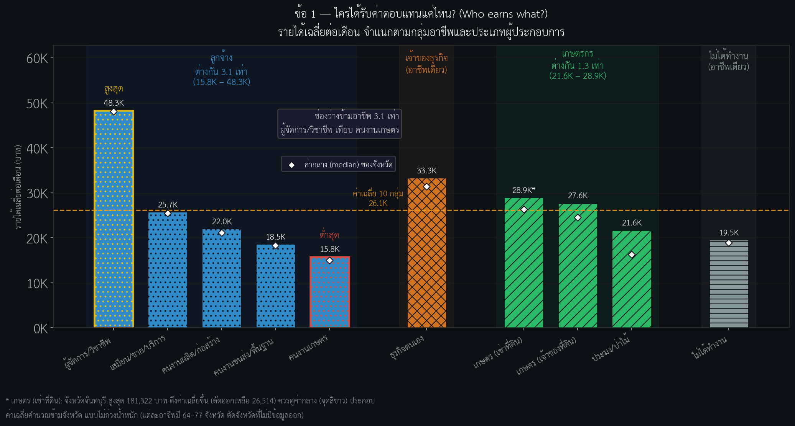
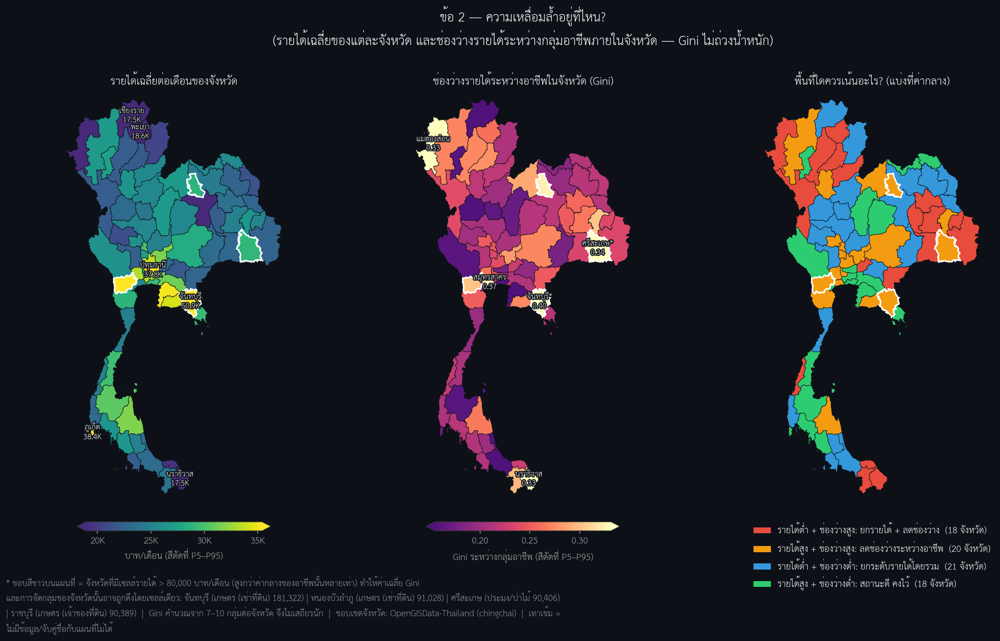
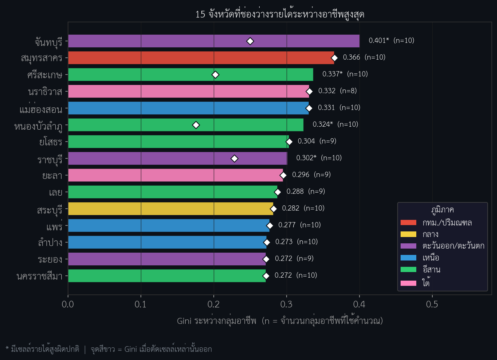
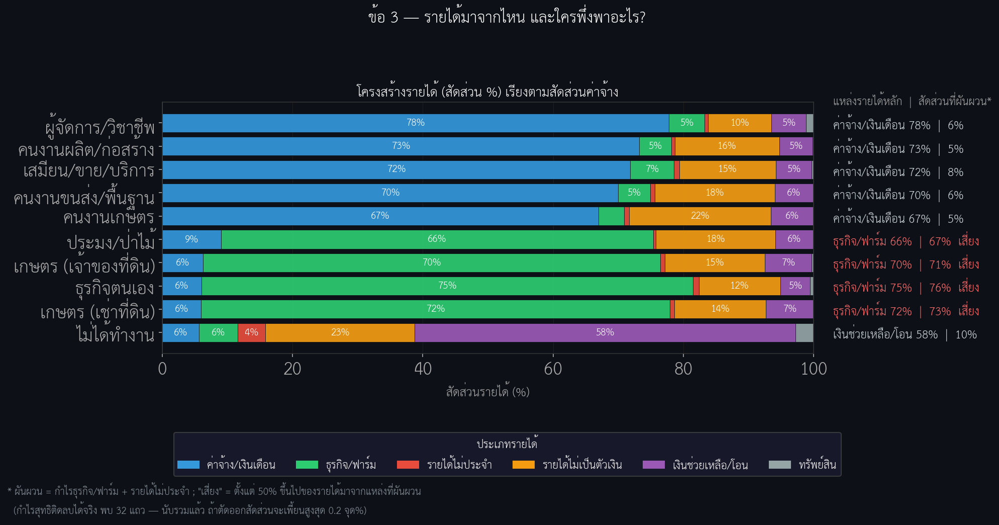

# 📊 Data Storytelling: Thailand Household Income & Inequality

> **An exploratory data analysis (EDA) of household income and income gaps across provinces and occupations in Thailand.**
> *Developed as part of the Super AI Engineer Season 6 (Mini-Hackathon Level 1).*

---

## 📑 Table of Contents

- [Project Objective](#-project-objective)
- [Data Source](#-data-source)
- [Technical Skills Demonstrated](#-technical-skills-demonstrated)
- [Project Structure & Workflow](#-project-structure--workflow)
- [Key Findings](#-key-findings)
- [Methodological Notes & Data Limitations](#-methodological-notes--data-limitations)
- [How to Run the Code](#-how-to-run-the-code)

---

## 🎯 Project Objective

To understand the structure of household income in Thailand and answer three questions:

| # | Question | What it asks |
|---|---|---|
| **Q1** | **Who earns what?** | Which occupations earn the most and the least, and how large is the gap? |
| **Q2** | **Where is the income gap?** | Which provinces show the largest gaps between occupational groups, and where should policy focus on raising income vs. reducing the gap? |
| **Q3** | **Where does income come from?** | Which occupations depend on which income sources, and which are exposed to volatile income? |

---

## 📊 Data Source

Secondary, aggregated data from the **National Statistical Office (NSO) of Thailand**.

| Item | Details |
|---|---|
| **Dataset** | `avg_income.csv`: average monthly household income by income source and socio-economic class, 2566 B.E. (2023) |
| **Size** | 7,700 records × 11 columns = 77 provinces × 10 socio-economic classes × 10 income-source rows |
| **Unit** | Baht per month. Each value is a *group average* (province × occupational class), not a household record |
| **Province boundaries** | `provinces.geojson`, from the [OpenGISData-Thailand](https://github.com/chingchai/OpenGISData-Thailand) project (Q2 maps only). The notebook downloads it automatically on the first run |

> [!WARNING]
> **Hierarchy in the data:** the `value` column mixes hierarchy levels (total → regular / irregular → monetary / non-monetary → individual sources), so totals and their components must never be added together.

---

## 🔧 Technical Skills Demonstrated

| Area | Details |
|---|---|
| **Programming** | Python (Pandas, NumPy) |
| **Data quality & cleaning** | Audit trail and cleaning log, missing-value handling, string cleaning, label mapping, hierarchy consistency checks (components sum to totals) |
| **Statistical analysis** | Gini coefficient, coefficient of variation (CV) and robust CV, income-share structure, sensitivity analysis (outliers and negative values) |
| **Data visualization** | Matplotlib and Seaborn (histogram + KDE, box plots, annotated bar charts, 100% stacked bars), plus province choropleth maps drawn with plain `json` + Matplotlib (no GeoPandas needed) |

---

## 📂 Project Structure & Workflow

The sections below follow the numbering of the notebook.

### 1. Setup & Load Data

Installs the Thai font (TH Sarabun New), downloads `avg_income.csv` with `wget`, and loads it.

### 2. Data Quality Audit

Because `value` mixes hierarchy levels, statistics and outliers are computed **per indicator series** (`source_income1 × source_income2 × source_income3`), not on the whole column at once.

**Audit trail:** logs timestamp, row/column counts, nulls, duplicates, zero and negative values, and IQR outliers, and appends them to `data_quality_audit_log.csv` on every run.

**What it found:**

| Check | Result |
|---|---|
| Missing values | Only `attribute` (a footnote column): 6,865 rows (89.2%) |
| Duplicate rows | 0 |
| Zero values | 835 |
| Negative values | 36 |
| IQR outliers (within each series) | 639 |

### 3. Data Cleaning

All steps run in one cell, work on a copy of the raw data, and are written to the cleaning log. **No rows are removed.**

| Step | Action | Removed | Modified |
|---|---|---|---|
| 1 | Strip leading/trailing whitespace in text columns | 0 | 0 |
| 2 | Drop duplicates | 0 | 0 |
| 3 | Fill null `attribute` with "ไม่มี" ("none") | 0 | 6,865 |
| 4 | **Keep** negative values (36 rows) and add an `is_negative` flag. 32 are net farm-profit losses; the other 4 are totals that include them | 0 | 0 |
| 5 | Total-income rows with a "W" footnote (sample-based zero) → `NaN`, treated as "no data", not imputed | 0 | 25 |
| 6 | Add concise labels: `occ1` (4 primary groups) and `occ2` (10 sub-occupations) | 0 | 0 |
| 7 | Check the nested hierarchy: total = sum of components | 0 | 0 |

> [!NOTE]
> **Why negatives are kept:** the data is nested (total = sum of components). Removing a negative farm profit would make the components add up to more than the true total.
>
> **Why only total-income zeros become `NaN`:** a group's total income cannot realistically be 0, so it means "no data". A zero in a single source (e.g. no business profit) is a real zero and is kept.

**Outliers are never removed or clipped.** Besides the IQR count in the audit, the analysis marks four cells above **80,000 baht/month** (shown with `*` in charts and a white outline on maps):

| Province | Occupation | Baht/month |
|---|---|---:|
| Chanthaburi | Tenant farmers | 181,322 |
| Nong Bua Lamphu | Tenant farmers | 91,028 |
| Si Sa Ket | Fishing/forestry | 90,406 |
| Ratchaburi | Owner farmers | 90,389 |

**Consistency checks**

- All three levels of the hierarchy match within a 5-baht tolerance: total = regular + irregular; regular = monetary + non-monetary; monetary = its five components.
- 0 mismatches; the largest difference is 2 baht (rounding).
- There is exactly one row per province × occupation (10 per province).

**Usable data:** 745 of 770 province × occupation cells have a valid total income.

### 4. Exploratory Data Analysis & Inequality KPIs

| Section | What it covers |
|---|---|
| **4.1 Distribution** | Histogram + KDE of total monthly income (right-skewed: mean ≈ 26,177 vs. median ≈ 22,824 baht) and box plots by sub-occupation (`occ2`), coloured by primary group (`occ1`) |
| **4.2 Gini coefficient** | Overall, by primary group (`occ1`) and by sub-occupation (`occ2`). Province-level Gini is computed in Q2 |
| **4.3 Variation within each sub-occupation (between provinces)** | CV and a robust CV (IQR / 1.349 ÷ median) that resists extreme values |

### 5. Data Storytelling (3 questions)

#### Q1: Who earns what?

One bar per sub-occupation, grouped by primary group, with the highest and lowest highlighted, median markers, the mean line, and the max/min gap inside each group. `*` marks a group whose average is pulled up by a single province.

  

#### Q2: Where is the gap?

Three province maps: (1) average income, (2) between-occupation Gini with the top 5 labelled, and (3) a "what to focus on" map that splits provinces into four groups by income and gap.

  

How the four groups are defined

 

Provinces are split at the median income (25,395 baht) and median Gini (0.218):

| Group | Provinces |
|---|---:|
| Low income + high gap | 18 |
| High income + high gap | 20 |
| Low income + low gap | 21 |
| High income + low gap | 18 |

A ranked top 15 bar chart (coloured by region) shows each province's Gini and its value after excluding cells above 80,000 baht.

  

#### Q3: Where does income come from?

100% stacked bars of six income types per sub-occupation, sorted by wage share. Each row shows the main source and the share from volatile sources (business/farm profit + irregular income). A group is marked "risky" when that share is 50% or more.

> [!TIP]
> **Insight:** 4 of 10 groups (fishing/forestry, self-employed, and both farmer groups) get 67–76% of their income from volatile sources, versus only 5–8% for the five employee groups. Non-working households depend on transfers for 58% of income.

  

Income types and method

 

The six income types are wages, business/farm profit, irregular income, non-monetary income, transfers, and property income. Only the lowest-level components are used, so nothing is double-counted.

#### Policy observations

A table generated directly from the data, so its numbers always match the charts.

---

## 🔎 Key Findings

- **Occupation gap:** managers/professionals earn about 48.3K baht/month vs. about 15.8K for agricultural laborers, roughly **3.1×**. Both are employees, so the widest gap is inside the employee group; among farmers the gap is only about 1.3× (21.6K–28.9K).

- **Between-group inequality is moderate:** Gini ≈ **0.26** across all 745 province × occupation groups. By primary group, farmers are highest (≈ 0.30) and business owners and non-working households lowest (≈ 0.14). By sub-occupation, fishing/forestry is highest (≈ 0.34).

- **Top provinces need a caveat:** Chanthaburi ranks first on Gini (≈ 0.40) mainly because one group (tenant farmers, ≈ 181K baht/month, about 6.9× that occupation's median) sits far above the rest and may reflect a small sample. Si Sa Ket, Nong Bua Lamphu and Ratchaburi in the top 15 are affected by a single extreme cell in the same way, so their rankings should be read with care.

- **Income structure:** employees get roughly 67–78% of income from wages. Farmers, fishers and the self-employed get roughly 66–75% from business/farm profit, which is volatile and can turn negative; 67–76% of their income comes from volatile sources, so all four groups are flagged as risky.

- **Transfers are small for working groups but not for everyone:** government/other transfers are only about 5–7% of income in the nine working groups, yet they are the main source (≈ 58%) for non-working households, whose average income is ≈ 19.5K baht (rank 8 of 10).

---

## 🚧 Methodological Notes & Data Limitations

### What the Gini measures

- The dataset holds group averages without household counts or population weights, so the Gini figures measure the **gap between groups** (province × occupation), unweighted. They do not measure household-level inequality. Q2 applies this within each province: it captures the spread between occupations, not inequality among households.
- The overall Gini (≈ 0.26) is calculated across all 745 province × occupation groups, while the province-level Gini (maps and top-15 chart) is calculated within each province.
- These figures are not comparable with official indices built from microdata. Published household income Gini estimates for Thailand vary by source and definition (roughly 0.3–0.5), and hidden within-group inequality would likely make the true figures higher.
- Province-level Gini rests on only 7–10 groups per province, so it is sensitive to small samples and single extreme cells. The white diamonds in the top-15 chart show the value without them.

### Data handling

- Negative values (36 rows) were kept rather than removed. 32 of them are negative net farm profit and enter the Q3 income structure; the other 4 are in aggregate income columns (total monthly, monetary and regular income) that Q3 does not use. A sensitivity test that drops all negative rows changes the Q3 income shares by at most about 0.2 percentage points.
- 25 total-income cells flagged "0^W" in the source (the survey sample value is 0, and every income type in those cells is 0) were set to `NaN` and excluded, so averages use 64–77 provinces per occupation.
- The "non-working" group (households with no economic activity but with income) is included in all analyses, as part of all households.

### How to read the results

- All averages across provinces are unweighted: each province counts equally regardless of population.
- Single-province effects (e.g. Chanthaburi tenant farmers) are flagged but not removed, so read medians alongside means.

---

## 🚀 How to Run the Code

1. **Open the notebook.** Open `mini_Hackathon_week_1.ipynb` in Google Colab (upload it, or open it from GitHub via Colab). Rename the file if you like and update this line.
2. **Run the cells in order from the top.** The cleaning cell (Section 3) must run before the analysis cells, and later sections reuse objects defined earlier (e.g. `gini()` from 4.2 and the 80,000-baht threshold from 4.1).
3. **Data and font download automatically.** The first code cell downloads the dataset (`avg_income.csv`) and the Thai font with `wget`, so no manual upload is needed. If the dataset link has expired, place `avg_income.csv` in the working directory and skip the `wget` line.
4. **Internet is needed for the Q2 maps.** The Q2 cell also downloads the province boundaries (`provinces.geojson`) automatically on its first run.

### Outputs

- `data_quality_audit_log.csv` (one row appended per run)
- Figures: `fig1_overall_dist.png`, `fig4_cv_by_occ2.png`, `q1_income_by_occupation.png`, `q2_geographic_inequality_map.png`, `q2_top15_gini.png` and `q3_income_structure.png`
---
*Created by Poomrat Thanapasee | Connect with me on [LinkedIn](https://www.linkedin.com/in/poomrat-thanapasee-6a99443b3/)*
